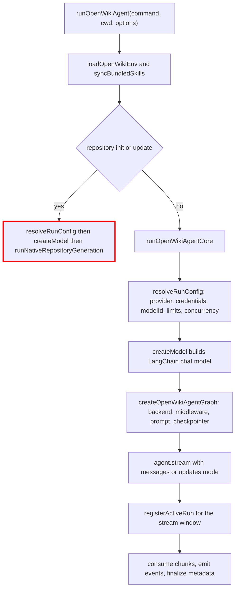

# [LLM Wiki理论与实践-11]openwiki --init|--update的实现

通过前面的文章我们知道OpenWiki具有Personal和Code两种执行模式，前者用来构建个人知识库，后者辅助Coding Agent编程。Code模式既可以通过独立执行命令行的形式来完成，又可以作为MCP服务器挂载到Coding Agent上，以工具函数的形式提供服务。两种模式均提供了init、update和chat（默认命令）三种核心命令，分别用于OpenWiki的初始化、增量更新和与用户对答。两种执行模式 + 三种核心命令，一共六种组合，[LLM Wiki理论与实践-07：用来生成OpenWiki知识库和完成对话的Agent]介绍的DeepAgent用来处理其中四种组合，本篇文章主要关注余下的两种组合（Code + init， Code + update）

## 1. 完整的执行流程

如下这张流程图是[OpenWiki官方github](https://github.com/langchain-ai/openwiki/blob/main/openwiki/architecture/agent-runtime.md)提供的，揭示了OpenWiki底层的核心执行流程，其本质是一个根据命令类型分流、高度沙箱化、并具备崩溃保护的闭环生命周期。

入口函数`runOpenWikiAgent`启动后，首先通过`resolveRunConfig`解析环境变量，确定使用的LLM提供商（如OpenAI、Anthropic、AWS Bedrock等）及凭证。随后，根据提供商的能力矩阵通过`createModel`实例化对应的LangChain LLM客户端，并注入推理强度、最大输出 Token 及流式传输等参数。LLM就绪后，流程会根据任务类型严格分流：

- **Code + init|update**：直接交由`runNativeRepositoryGeneration`处理。它跳过 DeepAgent 图，启动自己的规划器（Planner）和并发的页面工作池（Page-worker pool）。通过共享的 LangSmith trace 线程，并发处理各个页面的生成，并通过严格的Claim校验进行提交。
- **Personal|Chat**：通过`runOpenWikiAgentCore`构建`DeepAgent`，[LLM Wiki理论与实践-07：用来生成OpenWiki知识库和完成对话的Agent](https://jaydenai.blog.csdn.net/article/details/170457572)对`DeepAgent`的创建流程提供了详细介绍。接下来就是将用户消息作为输入调用`DeepAgent`对象的`stream`方法。对于代理图产生的数据流，通过`parseAgentStreamChunk`管线将其剥离、还原为纯文本或工具事件，并交给注册的处理器进行处理。